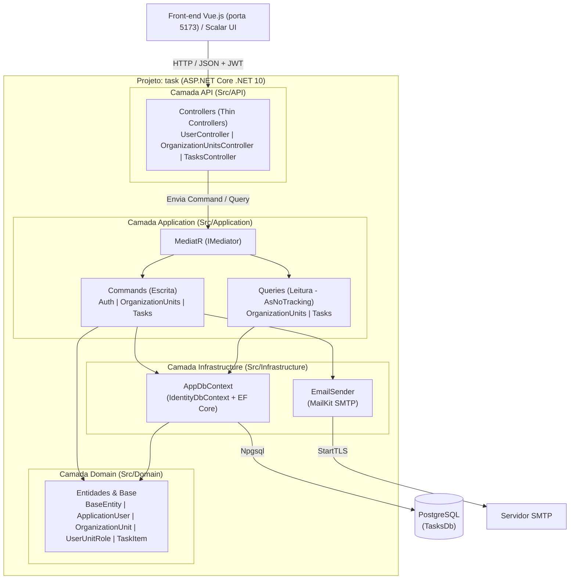
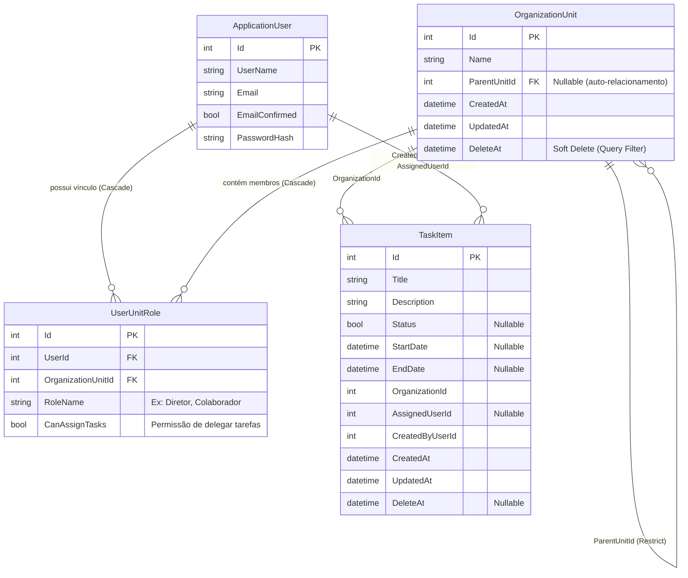
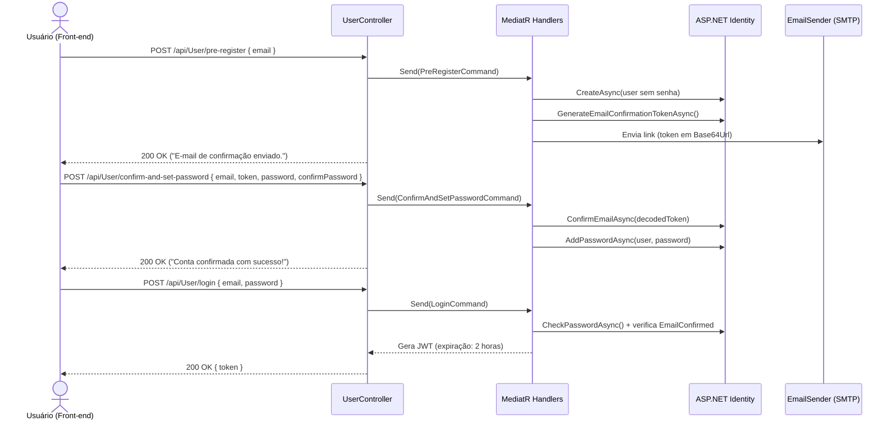

# Tasks Backend API

API RESTful para gerenciamento corporativo de tarefas, usuários e estrutura organizacional hierárquica (diretorias, setores e vínculos de permissão), desenvolvida em **.NET 10** seguindo princípios de **Clean Architecture** e **CQRS** com **MediatR**.

---

## Sumário

1. [Visão Geral](#-visão-geral)
2. [Stack Tecnológica](#-stack-tecnológica)
3. [Arquitetura do Projeto](#-arquitetura-do-projeto)
4. [Estrutura de Pastas](#-estrutura-de-pastas)
5. [Modelo de Domínio e Banco de Dados](#-modelo-de-domínio-e-banco-de-dados)
6. [Fluxos Principais](#-fluxos-principais)
7. [Endpoints da API](#-endpoints-da-api)
8. [Testes Automatizados](#-testes-automatizados)
9. [Configuração e Execução](#-configuração-e-execução)
10. [Pontos de Atenção e Evolução](#-pontos-de-atenção-e-evolução)

---

## 🎯 Visão Geral

O **Tasks Backend** foi projetado para atender um front-end SPA em **Vue.js (Vite)** (`http://localhost:5173`), fornecendo:

- **Onboarding seguro em duas etapas**: pré-cadastro por e-mail com envio de link de ativação via SMTP e posterior definição de senha.
- **Autenticação e Autorização**: baseada em **ASP.NET Core Identity** (com chaves inteiras `int`) e tokens **JWT Bearer**.
- **Hierarquia Organizacional**: cadastro de unidades/setores em árvore auto-relacionada (`OrganizationUnit`), permitindo representar diretorias, departamentos e subsetores, além de papéis por setor (`UserUnitRole`) com controle de delegação de tarefas (`CanAssignTasks`).
- **Gestão de Tarefas (CRUD)**: criação, listagem, consulta individual, atualização e remoção de tarefas vinculadas a organizações e usuários.

---

## 🚀 Stack Tecnológica

| Categoria | Tecnologia / Pacote | Versão | Finalidade |
| :--- | :--- | :--- | :--- |
| **Runtime / Framework** | .NET / ASP.NET Core Web API | `net10.0` | Base da aplicação e servidor HTTP |
| **Arquitetura Interna** | MediatR | `14.1.0` | Implementação do padrão Mediator e CQRS |
| **ORM** | Entity Framework Core | `10.0.6` | Mapeamento objeto-relacional e Migrations |
| **Banco de Dados** | PostgreSQL (`Npgsql.EntityFrameworkCore.PostgreSQL`) | `10.0.1` | Persistência relacional principal |
| **Identidade** | ASP.NET Core Identity EF Core | `10.0.6` | Gestão de usuários, senhas, tokens de confirmação e roles |
| **Autenticação** | JWT Bearer (`Microsoft.AspNetCore.Authentication.JwtBearer`) | `10.0.14` | Autenticação stateless via token JWT (`HMAC-SHA256`) |
| **Mensageria / E-mail** | MailKit / MimeKit | `4.16.0` | Disparo de e-mails transacionais via SMTP (`StartTLS`) |
| **Documentação OpenAPI** | Microsoft.AspNetCore.OpenApi + Scalar.AspNetCore | `10.0.4` / `2.14.0` | Especificação OpenAPI e interface interativa Scalar |
| **Testes** | xUnit + FluentAssertions + EF Core InMemory | `2.9.3` / `7.0.0` | Testes de unidade e integração em memória |

---

## 🏛️ Arquitetura do Projeto

O sistema adota **Clean Architecture (Arquitetura Limpa)** combinada com **CQRS (Command Query Responsibility Segregation)**, organizada por **camadas lógicas** dentro do projeto principal (`task/Src`). Essa abordagem mantém baixo acoplamento e alta coesão sem a sobrecarga inicial de múltiplos projetos `.csproj` separados.



### Principais Padrões Aplicados

1. **Thin Controllers + Mediator Pattern**:
   Os `Controllers` atuam apenas como adaptadores HTTP — recebem o payload, enviam um `Command` ou `Query` através do `IMediator` e traduzem o resultado em códigos de status HTTP (`200 OK`, `201 Created`, `400 BadRequest`, `401 Unauthorized`, `404 NotFound`).
2. **CQRS (Separação entre Leitura e Escrita)**:
   - **Commands** (`CreateTaskCommand`, `UpdateTaskCommand`, `PreRegisterCommand`, etc.) encapsulam intenções de mudança de estado e regras de negócio.
   - **Queries** (`GetAllTasksQuery`, `GetTaskByIdQuery`, `GetAllOrganizationUnitsQuery`) realizam consultas otimizadas com `.AsNoTracking()` e projeção direta (`.Select(...)`) para DTOs de resposta, evitando rastreamento desnecessário do EF Core.
3. **Auditoria Automática e Soft Delete**:
   - Entidades de negócio herdam de `BaseEntity` (`Id`, `CreatedAt`, `UpdatedAt`, `DeleteAt`).
   - O `AppDbContext.SaveChangesAsync` intercepta automaticamente entidades `Added` e `Modified` no `ChangeTracker` para preencher `CreatedAt` e `UpdatedAt` em UTC.
   - A entidade `OrganizationUnit` possui **Global Query Filter** (`HasQueryFilter(o => o.DeleteAt == null)`), filtrando registros excluídos logicamente de forma transparente.
4. **Options Pattern**:
   Configurações fortemente tipadas com `IOptions<EmailSettings>` e `IOptions<AppSettings>` injetadas via container de DI nativo no `Program.cs`.

---

## 📂 Estrutura de Pastas

```text
Tasks-Backend/
├── task.slnx                                      # Solução .NET (formato XML moderno)
└── task/                                          # Projeto Web API principal
    ├── Program.cs                                 # Composição de DI, Auth JWT, CORS, OpenAPI/Scalar e Pipeline HTTP
    ├── appsettings.json                           # Configurações de conexão, SMTP e URL do front-end
    ├── task.csproj                                # Definição do projeto e pacotes NuGet
    ├── Src/
    │   ├── API/                                   # Camada de Apresentação / Entrada HTTP
    │   │   ├── Controllers/
    │   │   │   ├── UsersController.cs             # Endpoints de autenticação, pré-registro e perfil (/api/User)
    │   │   │   ├── OrganizationUnitsController.cs # Endpoints de setores/unidades (/api/OrganizationUnits)
    │   │   │   └── TasksController.cs             # CRUD completo de tarefas (/api/Tasks)
    │   │   └── Middlewares/                       # Reservado para middlewares customizados (ex.: Exception Handling)
    │   │
    │   ├── Application/                           # Camada de Aplicação (Casos de Uso / CQRS)
    │   │   ├── Auth/Commands/                     # LoginCommand, PreRegisterCommand, ConfirmAndSetPasswordCommand
    │   │   ├── OrganizationUnits/
    │   │   │   ├── Commands/                      # CreateOrganizationUnitCommand
    │   │   │   └── Queries/                       # GetAllOrganizationUnitsQuery
    │   │   ├── Tasks/
    │   │   │   ├── Commands/                      # CreateTaskCommand, UpdateTaskCommand, DeleteTaskCommand
    │   │   │   ├── Queries/                       # GetAllTasksQuery, GetTaskByIdQuery
    │   │   │   └── Dto/                           # Objetos de transferência de dados (TaskResponse)
    │   │   └── Mappings/                          # Reservado para mapeadores de objetos
    │   │
    │   ├── Domain/                                # Camada de Domínio (Núcleo de Negócio)
    │   │   ├── Common/                            # BaseId<TId> e BaseEntity<TId> (Auditoria e Soft Delete)
    │   │   ├── Entities/
    │   │   │   ├── Identity/                      # ApplicationUser e AssignUserRoleCommand
    │   │   │   ├── Organization/                  # OrganizationUnit (árvore) e UserUnitRole (vínculo/permissão)
    │   │   │   └── Tasks/                         # TaskItem e Category
    │   │   └── Interfaces/                        # Reservado para contratos de repositórios/serviços
    │   │
    │   └── Infrastructure/                        # Camada de Infraestrutura (Dados e Serviços Externos)
    │       ├── Data/
    │       │   ├── Context/AppDbContext.cs        # Contexto EF Core + Identity + Fluent API
    │       │   └── Migrations/                    # Histórico de migrações do PostgreSQL
    │       └── Services/
    │           ├── AppSettings.cs                 # Configuração de FrontendUrl
    │           └── Email/                         # EmailSender (MailKit) e EmailSettings
    │
    └── Tests/
        └── task.Tests/                            # Projeto de Testes Automatizados (xUnit)
            ├── Application/                       # Testes de handlers/persistência com EF Core InMemory
            └── Domain/                            # Testes de regras de domínio (OrganizationUnit, UserUnitRole)
```

> **Nota sobre o `.csproj`**: O arquivo `task/task.csproj` exclui explicitamente a pasta `Tests/**` da compilação da API (`<Compile Remove="Tests\**\*.cs" />`), permitindo que o projeto de testes `task.Tests.csproj` conviva dentro da árvore de diretórios sem conflitos de build.

---

## 🗄️ Modelo de Domínio e Banco de Dados

O `AppDbContext` herda de `IdentityDbContext<ApplicationUser, IdentityRole<int>, int>`, unificando no banco **PostgreSQL** tanto as tabelas padrão do ASP.NET Core Identity (`AspNetUsers`, `AspNetRoles`, `AspNetUserRoles`, etc. com chave primária `int`) quanto as tabelas de negócio.



### Histórico de Migrations

1. `20260416231256_InitialIdentity`: Criação da estrutura base do ASP.NET Core Identity com chaves `int`.
2. `20260417000015_HierarchyTables`: Criação de `OrganizationUnits` (com auto-relacionamento restrito contra deleção em cascata acidental) e `UserUnitRoles`.
3. `20260417040945_AddAuditableAndSoftDeleteToOrganization`: Adição de colunas de auditoria (`CreatedAt`, `UpdatedAt`) e exclusão lógica (`DeleteAt`) em `OrganizationUnits`.
4. `20260506031332_AddTaskItemsTable`: Criação da tabela `TaskItems`.

---

## 🔄 Fluxos Principais

### Fluxo de Onboarding e Autenticação

O cadastro não recebe senha imediatamente: garante-se primeiro a posse do e-mail antes da ativação da conta.



---

## 🌐 Endpoints da API

### 1. Usuários e Autenticação (`/api/User`)
> *Definido por `UserController` em `Src/API/Controllers/UsersController.cs`.*

| Método | Rota | Auth | Descrição |
| :--- | :--- | :---: | :--- |
| `POST` | `/api/User/pre-register` | Público | Cria pré-cadastro pelo e-mail e dispara link de ativação |
| `POST` | `/api/User/confirm-and-set-password` | Público | Valida token do e-mail, confirma conta e cadastra a senha |
| `POST` | `/api/User/login` | Público | Autentica usuário confirmado e retorna o token JWT |
| `POST` | `/api/User/assign-role` | Público* | Atribui (e cria se não existir) uma role global ao usuário |
| `GET` | `/api/User/me` | `Bearer` | Retorna `Id`, `Email` e `Roles` do usuário autenticado |

### 2. Unidades Organizacionais (`/api/OrganizationUnits`)

| Método | Rota | Auth | Descrição |
| :--- | :--- | :---: | :--- |
| `POST` | `/api/OrganizationUnits` | Público* | Cria um novo setor/unidade (raiz ou filho via `ParentUnitId`) |
| `GET` | `/api/OrganizationUnits` | `Bearer` | Lista todas as unidades organizacionais ativas |

### 3. Tarefas (`/api/Tasks`)

| Método | Rota | Auth | Descrição |
| :--- | :--- | :---: | :--- |
| `POST` | `/api/Tasks` | `Bearer` | Cria uma nova tarefa e retorna `201 Created` |
| `GET` | `/api/Tasks` | `Bearer` | Lista todas as tarefas cadastradas |
| `GET` | `/api/Tasks/{id}` | `Bearer` | Obtém os detalhes de uma tarefa específica pelo ID |
| `PUT` | `/api/Tasks/{id}` | `Bearer` | Atualiza título, descrição, status e data final da tarefa |
| `DELETE` | `/api/Tasks/{id}` | `Bearer` | Remove uma tarefa pelo ID |

---

## 🧪 Testes Automatizados

O projeto de testes fica em `task/Tests/task.Tests/task.Tests.csproj` e utiliza **xUnit**, **FluentAssertions** e **EF Core InMemory**:

- **`OrganizationUnitTests`**: valida a construção da hierarquia pai/filho entre diretorias e setores e regras de auto-referência.
- **`UserUnitRoleTests`**: valida os vínculos de usuários em unidades organizacionais com e sem permissão de delegação (`CanAssignTasks` para Diretor vs. Colaborador).
- **`CreateOrganizationUnitCommandHandlerTest`**: valida a persistência de unidades organizacionais utilizando banco em memória (`UseInMemoryDatabase`).

Para executar a suíte de testes:

```powershell
dotnet test task/Tests/task.Tests/task.Tests.csproj
```

---

## ⚙️ Configuração e Execução

### Pré-requisitos
- **.NET 10 SDK** instalado
- Instância do **PostgreSQL** em execução (padrão porta `5432`)

### 1. Configurar variáveis no `task/appsettings.json` (ou User Secrets)

Ajuste a string de conexão do PostgreSQL, a chave JWT, o servidor SMTP e a URL do front-end:

```json
{
  "ConnectionStrings": {
    "DefaultConnection": "Host=localhost;Port=5432;Database=TasksDb;Username=postgres;Password=SUA_SENHA"
  },
  "Jwt": {
    "SecretKey": "SUA_CHAVE_SECRETA_COM_PELO_MENOS_32_CARACTERES"
  },
  "EmailSettings": {
    "Host": "smtp.gmail.com",
    "Port": 587,
    "SenderEmail": "seu-email@dominio.com",
    "SenderName": "Task App",
    "Password": "SUA_APP_PASSWORD"
  },
  "AppSettings": {
    "FrontendUrl": "http://localhost:5173"
  }
}
```

### 2. Aplicar as Migrations no PostgreSQL

```powershell
dotnet ef database update --project task/task.csproj
```

### 3. Executar a API

```powershell
dotnet run --project task/task.csproj
```

- **HTTP**: `http://localhost:5030`
- **HTTPS**: `https://localhost:7125`
- **Documentação Interativa (Scalar UI)** *(ambiente `Development`)*:
  - Acesse `http://localhost:5030/scalar/v1` (ou `https://localhost:7125/scalar/v1`).
  - O documento OpenAPI já inclui configuração de segurança global **Bearer JWT** para testar rotas autenticadas diretamente pela interface.

---

## 🛠️ Pontos de Atenção e Evolução

Durante a leitura da arquitetura atual, destacam-se os seguintes pontos já preparados ou recomendados para próximos passos:

1. **Segurança de Credenciais**: mover senhas de banco, `Jwt:SecretKey` e credenciais `EmailSettings` do `appsettings.json` para **User Secrets** (`dotnet user-secrets`) em desenvolvimento e variáveis de ambiente em produção.
2. **Proteção de Rotas Administrativas**: adicionar `[Authorize(Roles = "...")]` nos endpoints `POST /api/User/assign-role` e `POST /api/OrganizationUnits` conforme as políticas de acesso amadurecerem.
3. **Separação Estrita da Camada Domain**: mover `AssignUserRoleCommand` (atualmente em `Src/Domain/Entities/Identity/AssignUserRoleCommand.cs`) para `Src/Application/Auth/Commands/` para manter a camada `Domain` livre de dependências de casos de uso e `MediatR`.
4. **Unificação de DTOs e Datas de Tarefas**:
   - Existem duas classes `TaskResponse` (`Src/Application/Tasks/Dto/TaskResponse.cs` e outra declarada dentro de `GetTasksQueries.cs`) que podem ser unificadas.
   - No `CreateTaskCommandHandler`, os campos `StartDate` e `EndDate` recebidos no comando estão atualmente sendo inicializados como `null` na entidade `TaskItem`.
5. **Pastas Já Estruturadas para Expansão**:
   - `Src/API/Middlewares/`: ideal para um middleware global de tratamento de exceções (`ProblemDetails`) e validação.
   - `Src/Domain/Entities/Tasks/Category.cs`: esqueleto pronto para categorização de tarefas.
   - `Src/Domain/Interfaces/` e `Src/Application/Mappings/`: prontos para inversão de dependência e mapeamento padronizado.

